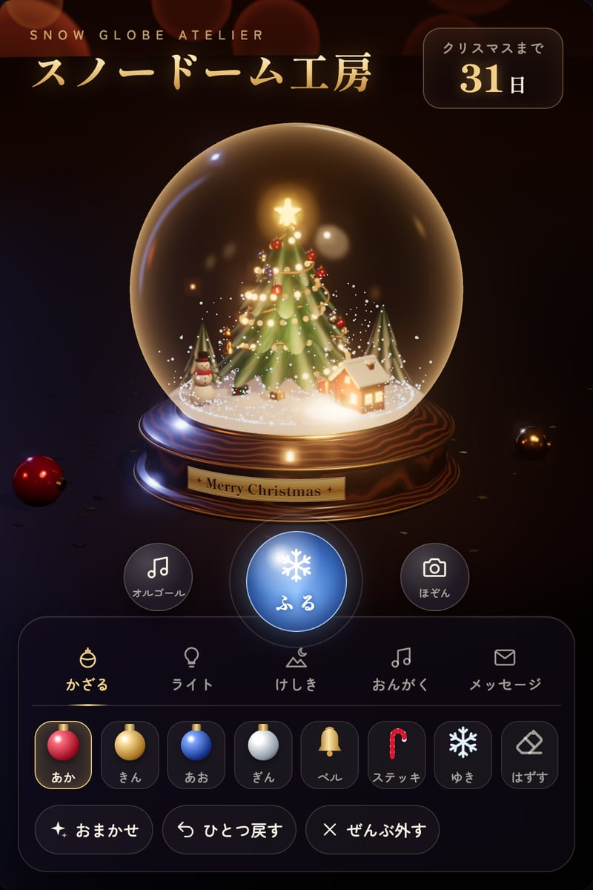
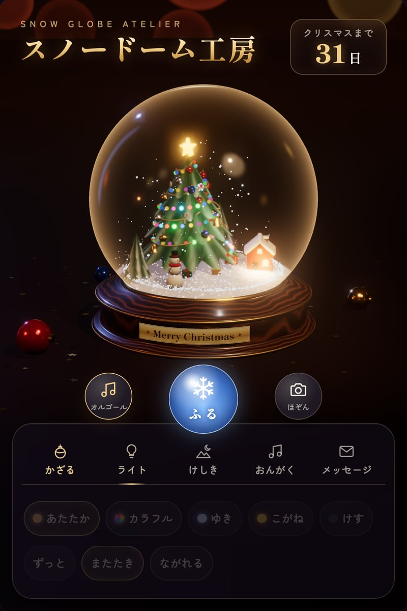
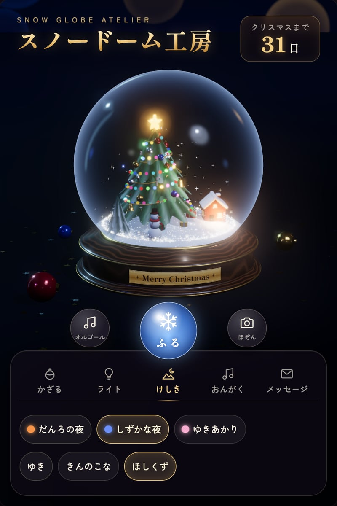
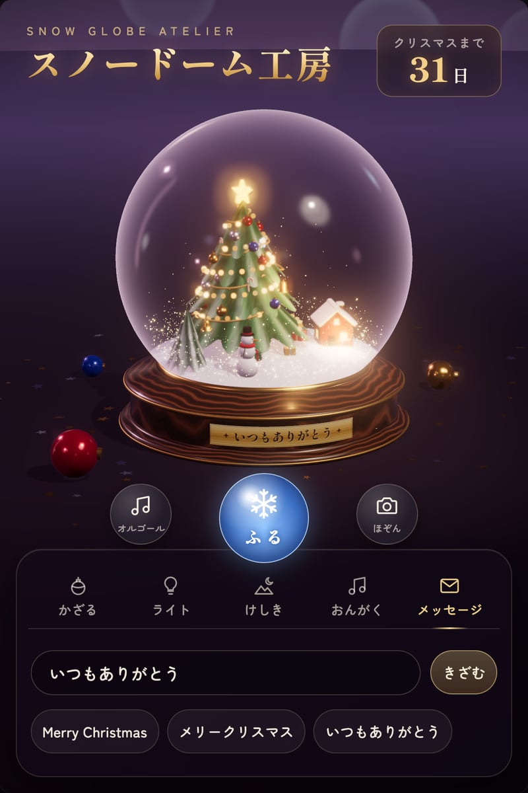

# スノードーム工房 — Snow Globe Atelier

自分だけのスノードームを飾りつけて、ふって、雪を降らせる。ブラウザで動く 3D の Web アプリ。

[](https://tanuu5.github.io/snow-globe-atelier/)
[](https://www.anthropic.com/claude)
[](./LICENSE)

<p align="center">
  
</p>

<p align="center"><b><a href="https://tanuu5.github.io/snow-globe-atelier/">▶ ブラウザで開く：https://tanuu5.github.io/snow-globe-atelier/</a></b>（インストール不要）</p>

**Claude Code × Claude Opus 5.5（XHIGH）** で作りました。依頼 1 回、40 分ほどの作品です。

木の台座にガラスの球をのせたスノードームの中に、クリスマスツリー、小さな家、雪だるま、プレゼントが入っています。ツリーをタップしてオーナメントを飾り、「ふる」を押すと、ドームが持ち上がって揺れ、雪が渦を巻いて舞い、やがて地面に積もります。電球の色、部屋の雰囲気、降るもの、オルゴールの曲を選べて、台座のプレートには好きな言葉を刻めます。

画像・音声ファイルは使っていません。木目やプレートの模様はキャンバスで描き、オルゴールと効果音は Web Audio で合成しています。画面はいつも縦 2:3 の枠に収まります。

## スクリーンショット

<table>
  <tr>
    <td width="50%"><br><sub>だんろの夜。右上にはクリスマスまでの日数が出る。</sub></td>
    <td width="50%"><br><sub>電球はカラフル・ながれる。オルゴールが鳴っているあいだ、ドームがゆっくり回る。</sub></td>
  </tr>
  <tr>
    <td width="50%"><br><sub>ツリーをタップして飾る。玉が 4 色と、ベル・ステッキ・雪の結晶。</sub></td>
    <td width="50%"><br><sub>「ふる」と雪が渦を巻いて舞い、ゆっくり積もっていく。</sub></td>
  </tr>
  <tr>
    <td width="50%"><br><sub>しずかな夜。降るものを「ほしくず」にすると、星の粒がきらめく。</sub></td>
    <td width="50%"><br><sub>ゆきあかりの部屋と、きんのこな。台座のプレートにことばを刻める。</sub></td>
  </tr>
</table>

画像と動画は、すべて実際の画面です。

## 遊び方

| 操作 | 内容 |
| --- | --- |
| ツリーをタップ | 選んでいるオーナメントを付ける（「はずす」を選ぶと、タップした飾りを外す） |
| ドラッグ / ホイール | ドームのまわりを回る / 寄る・引く |
| 「ふる」ボタン・`Space` キー | ドームをふって雪を舞わせる |
| 「オルゴール」ボタン・`M` キー | オルゴールを鳴らす・止める |
| 「ほぞん」ボタン | 今の画面を 1200×1800 の PNG で保存する |
| 星・家・雪だるま・プレゼント | タップすると、それぞれ反応する（家は窓の明かりがつく・消える） |

下のパネルの切り替え：

- **かざる**：オーナメント 7 種類と「はずす」、「おまかせ」（自動で 12 個飾る）、「ひとつ戻す」、「ぜんぶ外す」（2 回押し）
- **ライト**：電球の色（あたたか・カラフル・ゆき・こがね・けす）と光り方（ずっと・またたき・ながれる）
- **けしき**：部屋（だんろの夜・しずかな夜・ゆきあかり）と降るもの（ゆき・きんのこな・ほしくず）
- **おんがく**：オルゴールの曲（きよしこの夜・ジングルベル）と効果音のあり・なし
- **メッセージ**：台座のプレートに刻むことば（20 文字まで）

飾りつけと設定は、ブラウザの中（localStorage）にだけ保存され、次に開いたときに戻ります。どこにも送りません。音が出るので、音量にご注意ください。

PC のブラウザ（Chrome）で確かめています。画面の幅に合わせて枠ごと縮むので、スマホの縦画面にも収まります。

## 制作について

企画・ディレクション：**たぬ**　／　開発：**Claude Code（Claude Opus 5.5・推論レベル XHIGH）**

題材（スノードーム）の企画から、実装、調整までを Claude Code が進めました。見た目と操作は、ヘッドレス Chrome（実 GPU）で実際の画面を撮り、マウス操作で飾る・ふる・保存するを試しながら詰めています。

## 更新履歴

- **2026-11-24**：公開

## 開発

ビルドは不要です。`index.html` をブラウザで開くだけで動きます。three.js と Web フォントは CDN から読み込むので、インターネット接続が必要です。

確認用のサーバー（画面を撮って `shots/` に保存する口つき）：

```bash
node dev/dev-server.mjs --port 5181
```

| URL パラメータ | 内容 |
| --- | --- |
| `?dev` | 確認・撮影用のフック `window.__dev` を有効にする（保存した飾りは読まない） |
| `?dev&keep` | `?dev` のまま、保存した飾りを読む |
| `?fresh` | 保存した飾りを読まず、書きもしない |

`dev/` の中身は確認・撮影用で、`?dev` を付けたときだけ読み込まれます。

## クレジット・ライセンス

- コード：MIT License（[LICENSE](LICENSE)）© 2026 たぬ
- 3D 描画：[three.js](https://threejs.org/) r170（MIT License、jsDelivr から読み込み）
- フォント：Shippori Mincho B1 / Zen Maru Gothic（Google Fonts、SIL Open Font License）
- オルゴールの曲：「きよしこの夜」（フランツ・クサーヴァー・グルーバー作曲、1818 年）、「ジングルベル」（ジェームズ・ロード・ピアポント作曲、1857 年）。どちらもパブリックドメインの旋律を、コードで音にしています。
- MIT License の対象はこのリポジトリのコードと文章です。「Claude」の名前や商標の使用を許諾するものではありません。
